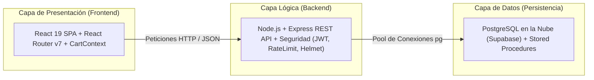
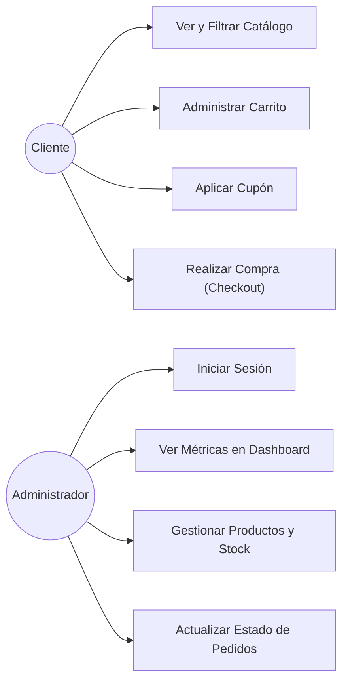

# Informe de Proyecto y Diagnóstico de Calidad de Software

**Proyecto Seleccionado:** Zzaly — Plataforma de Comercio Electrónico Transaccional  
**Estado:** Totalmente Funcional (Frontend React + Backend Express + Base de Datos PostgreSQL)

---

# PARTE 1: SELECCIÓN DEL OBJETO DE PRUEBA

## 1.1 Justificación del Grado de Dificultad ALTO
El proyecto seleccionado no es un CRUD básico de primeros semestres, sino una plataforma transaccional completa que resuelve problemas reales de consistencia y concurrencia:

1. **Control de Concurrencia e Inventario por Variantes:** El sistema administra stock diferenciado por combinación de prenda, talla y color (`zz_product_variants`). Para evitar sobreventas (*overselling*) cuando múltiples usuarios intentan comprar la última unidad al mismo tiempo, el backend delega la compra al procedimiento almacenado `process_checkout` en PostgreSQL, el cual bloquea las filas con `SELECT ... FOR UPDATE` para verificar y descontar existencias de forma atómica.
2. **Integridad Transaccional:** Si al momento de comprar una prenda se agota o los datos son inválidos, se ejecuta un `ROLLBACK` automático, impidiendo registros huérfanos o inconsistencias entre el inventario y los pedidos.
3. **Seguridad y Control de Acceso:** Cuenta con un panel administrativo protegido con autenticación Stateless mediante tokens `JWT`, contraseñas con hash `bcrypt` y protección contra ataques de fuerza bruta mediante `Rate Limiting`.

---

## 1.2 Arquitectura del Sistema
Arquitectura en tres capas desacoplada:



---

## 1.3 Requerimientos del Sistema

### Requerimientos Funcionales
- **RF-01 (Catálogo y Filtrado):** Visualizar prendas con filtros interactivos en tiempo real por categoría, talla, color, precio y búsqueda de texto.
- **RF-02 (Detalle de Producto):** Ver información completa de la prenda, galería de imágenes, selector de tallas/colores y verificación de stock disponible.
- **RF-03 (Carrito Persistente):** Agregar, modificar cantidades y eliminar productos, manteniendo los datos guardados en el navegador (`localStorage`).
- **RF-04 (Cupones de Descuento):** Validar códigos promocionales activos, verificando su vigencia, monto mínimo y límite de usos.
- **RF-05 (Proceso de Compra / Checkout):** Realizar compras como invitado ingresando datos de envío para Guatemala y generando un número de pedido único con descuento automático de inventario.
- **RF-06 (Autenticación de Administrador):** Inicio de sesión seguro con usuario y contraseña encriptada que emite un token JWT.
- **RF-07 (Dashboard Administrativo):** Visualizar métricas del negocio (total de ventas en Quetzales, cantidad de pedidos, productos por agotarse y órdenes recientes).
- **RF-08 (Gestión de Productos):** Crear, editar y eliminar productos con sus respectivas variantes de inventario e imágenes.
- **RF-09 (Gestión de Pedidos):** Consultar pedidos de clientes y cambiar su estado (`pendiente`, `en proceso`, `enviado`, `entregado`, `cancelado`).
- **RF-10 (Gestión de Cupones):** Crear y administrar códigos de promoción.

### Requerimientos No Funcionales
- **RNF-01 (Rendimiento):** Consultas indexadas en base de datos para tiempos de respuesta rápidos (<300ms).
- **RNF-02 (Seguridad):** Encriptación de claves con `bcrypt`, firmas de sesión con `JWT` y control de solicitudes continuas (*Rate Limiting*).
- **RNF-03 (Diseño Responsivo):** Interfaz adaptable a pantallas de computadoras, tablets y teléfonos móviles.
- **RNF-04 (Disponibilidad):** Base de datos alojada en la nube (Supabase) accesible 24/7.

---

## 1.4 Casos de Uso



### Detalle del Caso de Uso Principal: Realizar Compra (Checkout)
1. El cliente revisa su carrito y procede al pago.
2. Ingresa sus datos de entrega (nombre, teléfono, dirección y departamento de Guatemala).
3. Opcionalmente ingresa un cupón de descuento.
4. Presiona "Confirmar Pedido".
5. El backend recibe los datos e invoca el procedimiento almacenado `process_checkout` en PostgreSQL.
6. La base de datos bloquea las filas de las variantes elegidas, confirma que haya stock, descuenta las unidades, registra el pedido en `zz_orders` y sus ítems en `zz_order_items`.
7. Si alguna prenda ya no tiene stock, se cancela la transacción y se informa al usuario. Si es exitoso, se confirma el pedido y se limpia el carrito.

---

## 1.5 Diseños de Pantalla

- **Inicio (`/`):** Carrusel automático de imágenes con efecto suave y zoom, acceso rápido a categorías, banner de temporada y prendas destacadas.
- **Catálogo (`/catalogo`):** Barra lateral de filtros (precio, talla, color y categoría) con modal para ver detalles rápidos de cada prenda.
- **Carrito y Compra (`/carrito`):** Desglose de precios, cálculo de envío gratis (en compras > Q500), casilla de cupones y formulario de envío.
- **Panel Administrativo (`/admin`):** Dashboard con tarjetas de métricas, lista de pedidos con cambio de estado en vivo y formulario para agregar/editar productos.

---

## 1.6 Documentación Técnica Básica

### Estructura del Código
```
Ecommerce/
├── client/                     # Frontend (React 19 + Vite)
│   ├── public/images/          # Imágenes de la tienda
│   ├── src/
│   │   ├── components/         # Navbar, HeroCarousel, ProductCard, ProductDetail, etc.
│   │   ├── context/            # CartContext.jsx (Estado global del carrito)
│   │   ├── pages/              # Home, Catalog, Cart, Nosotros y módulo Admin/
│   │   └── index.css           # Estilos y variables visuales
│   └── package.json
│
└── server/                     # Backend (Node.js + Express)
    ├── db/                     # Conexión pool.js (Supabase) y archivo schema.sql
    ├── routes/                 # Rutas de la API (products, orders, checkout, auth, admin)
    ├── index.js                # Archivo principal del servidor
    └── package.json
```

### Endpoints Principales de la API
- `GET /api/products` — Lista productos con filtros (categoría, precio, talla, color, búsqueda).
- `GET /api/products/:id` — Detalle completo de una prenda con sus variantes.
- `POST /api/promos/validate` — Valida y calcula el descuento de un cupón.
- `POST /api/checkout/process` — Ejecuta la compra atómica en base de datos.
- `POST /api/auth/login` — Autentica administradores y emite el token JWT.
- `GET /api/admin/dashboard` — Retorna métricas de ventas y stock bajo.
- `GET / POST / PUT / DELETE /api/admin/products` — Gestión de productos.
- `GET / PUT /api/admin/orders` — Gestión y cambio de estados de pedidos.

### Variables de Entorno (`.env`)
- **Backend (`server/.env`):** `PORT=5000`, `DB_HOST`, `DB_USER`, `DB_PASSWORD`, `DB_NAME`, `JWT_SECRET`.
- **Frontend (`client/.env`):** `VITE_API_URL=http://localhost:5000/api`.

---

# PARTE 2: DIAGNÓSTICO DE CALIDAD

## 2.1 Definición del Problema que Resuelve y Funcionamiento Inicial

### ¿Qué problema resuelve la aplicación?
Permite a una tienda de ropa femenina vender en línea en Guatemala sin obligar a los clientes a registrarse previamente, resolviendo de forma segura el control de inventario en tiempo real para evitar que se vendan prendas agotadas cuando varios clientes compran simultáneamente.

### ¿Cómo funciona inicialmente?
1. **Inicio del Servidor:** El backend en Node.js se conecta a la base de datos PostgreSQL en Supabase, activa los middlewares de seguridad (`helmet`, `cors`, `rateLimit`) y expone las rutas REST bajo `/api/`.
2. **Carga del Frontend:** La aplicación en React se abre en el navegador, lee los productos desde el servidor, hidrata el estado del carrito desde `localStorage` y muestra la página de inicio con su carrusel y catálogo.
3. **Flujo de Compra:** El cliente navega, aplica filtros, añade prendas al carrito y al confirmar la orden, el procedimiento almacenado en la base de datos verifica y descuenta el stock de forma inmediata y segura.

---

## 2.2 Evaluación Justificada de Calidad

### 1. ¿Puedo arreglarlo? (Mantenibilidad)
> **Respuesta: SÍ.**  
> **Justificación:** El sistema está dividido en módulos independientes. En el backend, cada funcionalidad está en su propio archivo dentro de `routes/` (`products.js`, `checkout.js`, `admin.js`), por lo que corregir un fallo en compras no afecta el catálogo. En el frontend, los componentes de React son pequeños y aislados (`HeroCarousel.jsx`, `ProductCard.jsx`, `CartContext.jsx`), facilitando encontrar y solucionar errores rápidamente.

### 2. ¿Puedo probarlo? (Testabilidad)
> **Respuesta: SÍ.**  
> **Justificación:** Todas las rutas del backend son deterministas y pueden probarse directamente con herramientas como Postman o Thunder Client enviando datos en formato JSON sin necesidad de abrir la interfaz gráfica. Además, el proyecto cuenta con scripts (`seed.js`) para restablecer la base de datos con datos de prueba limpios en cualquier momento.

### 3. ¿Puedo modificarlo? (Flexibilidad)
> **Respuesta: SÍ.**  
> **Justificación:** Es fácil añadir nuevas características. En el backend se pueden agregar nuevas rutas o middlewares en Express sin modificar el código existente. En el frontend, los colores, tipografías y espaciados están centralizados mediante variables CSS en `index.css`, permitiendo cambiar el aspecto visual de toda la tienda desde un solo lugar.

### 4. ¿Puedo usarlo en otra máquina o navegador? (Portabilidad)
> **Respuesta: SÍ.**  
> **Justificación:** El servidor funciona sobre Node.js, lo que permite ejecutarlo en Windows, macOS o Linux sin cambios. La base de datos está en la nube (Supabase), permitiendo que cualquier equipo con conexión a internet se conecte. El frontend funciona de manera idéntica en los principales navegadores web (Chrome, Edge, Firefox, Safari) y en dispositivos móviles.

### 5. ¿Puedo reutilizar partes del Software? (Reutilización)
> **Respuesta: SÍ.**  
> **Justificación:** Varios componentes de la aplicación fueron creados para reutilizarse; por ejemplo, `ProductCard.jsx` se utiliza tanto en la página de inicio como en el catálogo pasándole los datos por propiedades. Asimismo, el hook `useCart` permite interactuar con el carrito desde cualquier parte de la interfaz y el middleware `isAdmin` protege cualquier ruta administrativa con una sola línea de código.

---

## 2.3 Infraestructura, Entorno Tecnológico y Planes Activos de Despliegue (Cierre al 27/10/2026)

Como parte de la entrega formal con fecha límite al **27 de Octubre de 2026**, se certifica y documenta la configuración operativa de los entornos de producción y aseguramiento de calidad (QA), garantizando la paridad entre las capas de presentación, lógica de negocio y persistencia de datos.

### 2.3.1 Matriz de Versiones de Software y Runtimes

| Componente de Arquitectura | Plataforma / Proveedor | Versión de Software Homologada | Justificación Técnica & Compatibilidad |
| :--- | :--- | :--- | :--- |
| **Backend Runtime** | **Render (Web Service)** | **Node.js v20 LTS** (`v20.x` / LTS estándar) | Seleccionado por ser la versión Long Term Support (LTS) más estable en Render, ofreciendo soporte nativo para `fetch` global, gestión optimizada de memoria en contenedores Linux y compatibilidad retroactiva total con entornos locales en Node.js v22.x. |
| **Motor de Base de Datos** | **Supabase / PostgreSQL** | **PostgreSQL 15.6 / 16 (Cloud)** <br> *(PostgreSQL 18.1 en entorno local)* | Motor relacional con soporte nativo para transacciones ACID, bloqueo de filas `SELECT ... FOR UPDATE`, procedimiento almacenado `process_checkout` en PL/pgSQL, tipos ENUM (`order_status`, `payment_status`, `discount_type`) y extensión `uuid-ossp`. |
| **Frontend Runtime / Build** | **Netlify (CI/CD)** | **Node.js v20.x + Vite 7 + React 19** | Proceso de empaquetado optimizado con `rollup` que compila la SPA a activos estáticos HTML/JS/CSS de alto rendimiento (`client/dist`). |

### 2.3.2 Planes Activos de Alojamiento y Características Operativas

| Servicio en la Nube | Plan Activo | Especificaciones del Plan | Configuración Operativa & Limitaciones Mitigadas |
| :--- | :---: | :--- | :--- |
| **Render** *(Backend API)* | **Free Web Service** | • 512 MB RAM dedicados para contenedor<br>• 0.1 vCPU compartida<br>• Certificado SSL/TLS Let's Encrypt automático<br>• IPs estáticas de salida (`74.220.48.0/24`, `74.220.56.0/24`)<br>• Dominio público: `https://ecommerce-na6d.onrender.com` | Se configuró el servicio web `ecommerce-backend` vinculado a la rama `qa`. Para mitigar la latencia por *cold start* (suspensión tras 15 min de inactividad del plan Free), se cuenta con el endpoint de monitoreo ligero `GET /api/health`. Las peticiones de QA cuentan con bypass de rate limiting mediante `QA_WHITELIST_IP`. |
| **Netlify** *(Frontend SPA)* | **Starter (Free)** | • 100 GB/mes de transferencia de datos<br>• 300 minutos mensuales de compilación (Build Time)<br>• Red CDN global Edge Anycast con baja latencia<br>• Soporte de HTTPS TLS 1.3 automático<br>• Dominio público: `https://ecommerce-frontend-qa.netlify.app` | Se automatizó el despliegue mediante el archivo `netlify.toml` en la raíz del repositorio, ejecutando `npm run build` en el directorio base `client` y publicando el directorio `dist`. Cuenta con reglas de reescritura de URL (`/* -> /index.html 200`) para el correcto funcionamiento de React Router. |
| **Supabase** *(Base de Datos)* | **Free Tier** | • 500 MB de almacenamiento relacional<br>• IPv4 Session Pooler en puerto 5432<br>• Transaction Pooler en puerto 6543<br>• Conexión SSL/TLS forzada (`ssl: { rejectUnauthorized: false }`) | Instancia dedicada para QA (`aws-1-us-west-2.pooler.supabase.com:5432/postgres`). Cuenta con script autocontenido `seed_qa.sql` para restauración instantánea en caso de reinicio de ciclo o pausa por inactividad. |

### 2.3.3 Sincronización de Variables de Entorno y Mitigación de Desincronizaciones (BUG-003)

Para erradicar definitivamente el defecto **BUG-003** (inconsistencias o fallas de comunicación provocadas por desalineación entre el Frontend en Netlify y el Backend en Render), se homologó la configuración de variables de entorno:

```
┌───────────────────────────────────────┐            ┌───────────────────────────────────────┐
│          NETLIFY (Frontend)           │            │           RENDER (Backend)            │
│   ecommerce-frontend-qa.netlify.app   │            │        ecommerce-na6d.onrender.com    │
├───────────────────────────────────────┤            ├───────────────────────────────────────┤
│ VITE_API_URL:                         │ ─────────> │ PORT: 5000                            │
│ https://ecommerce-na6d.onrender.com/api│            │ NODE_ENV: qa                          │
│                                       │            │ FRONTEND_URL:                         │
│ NODE_VERSION: 20                      │            │ https://ecommerce-frontend-qa.netlify │
│ Base Directory: client                │            │ DATABASE_URL: Supabase PostgreSQL     │
│ Publish Directory: dist               │            │ DB_SSL: true                          │
└───────────────────────────────────────┘            └───────────────────────────────────────┘
                                       \              /
                                        \            /
                                         ▼          ▼
                                   ┌───────────────────────────┐
                                   │   SUPABASE POSTGRESQL     │
                                   │    Ambiente Dedicado QA   │
                                   │  (Catálogo, Órdenes, etc.)│
                                   └───────────────────────────┘
```

1. **Variables Canónicas en Netlify (`netlify.toml`):**
   - `VITE_API_URL`: Apunta sin excepción a `https://ecommerce-na6d.onrender.com/api`.
   - `NODE_VERSION`: Fija el runtime de compilación en `20`.
   - Resiliencia en código: El frontend implementa un fallback canónico centralizado en `src/config/api.js` que impide desvíos hacia endpoints erróneos o locales ante compilaciones sin variable explícita.
2. **Variables Homologadas en Render (`render.yaml`):**
   - `DATABASE_URL`: Apunta a la misma instancia de Supabase PostgreSQL QA.
   - `FRONTEND_URL`: Autoriza el origen `https://ecommerce-frontend-qa.netlify.app` en las políticas de CORS de Express.
   - `DB_SSL`: Forzado a `true` para asegurar comunicación cifrada TLS con el pooler de base de datos.

