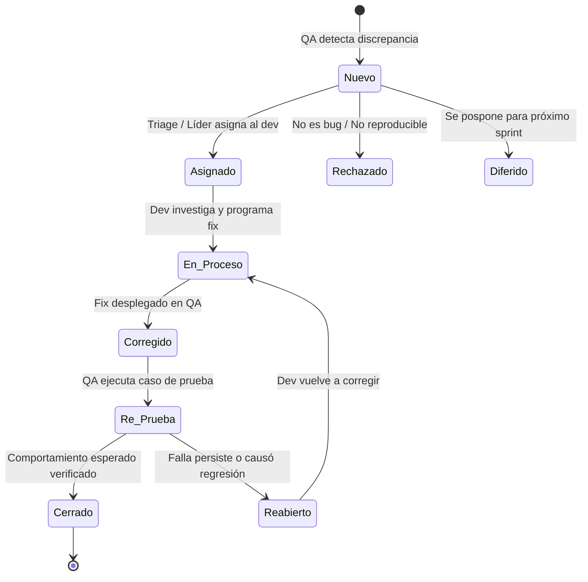

# 🎙️ Guía Maestra de Exposición: Calidad de Software (QA)
## Proyecto: E-Commerce `zzaly`
**Temas:** 1. Ambiente de Pruebas | 2. Ciclo de Vida de los Defectos | 3. Bitácora de Pruebas | 4. Gestión de Riesgos  
**Expositor:** Daniel Marroquín (Senior Backend & DevOps Lead)  
**Audiencia:** Evaluadores, Docentes y Equipo de Ingeniería

---

## 🎯 Estructura de la Presentación (4 Bloques Clave)

```
┌─────────────────────────────────────────────────────────────────┐
│                    PRESENTACIÓN DE QA Y TESTING                 │
├─────────────────┬───────────────────┬──────────────┬────────────┤
│ 1. AMBIENTE     │ 2. CICLO DE VIDA  │ 3. BITÁCORA  │ 4. RIESGOS │
│ DE PRUEBAS      │ DE LOS DEFECTOS   │ DE PRUEBAS   │ Y CONTROL  │
└─────────────────┴───────────────────┴──────────────┴────────────┘
```

---

# BLOQUE 1: Ambiente de Pruebas (Test Environment)

### 📌 ¿Qué es en teoría?
Es la infraestructura aislada y controlada (hardware, software, base de datos, red y configuraciones) configurada específicamente para ejecutar casos de prueba sin interferir con el entorno de desarrollo local ni poner en riesgo los datos de producción.

### 🏛️ Los 4 Componentes Clave:
1. **Infraestructura / Hardware:** Servidores de cómputo en la nube o locales.
2. **Software y Dependencias:** Runtime (Node.js v20), librerías, variables de entorno sanitizadas.
3. **Datos de Prueba (Test Data / Seeders):** Datasets deterministas con casos límite (productos sin stock, cupones vencidos, roles de usuario).
4. **Red y Seguridad:** Conexión segura TLS/SSL, IPs en lista blanca para evitar bloqueos por rate limiting.

### 💡 Ejemplo Real en Nuestro Proyecto (`zzaly`):
* **Servidor Web:** Desplegado en **Render** (`https://ecommerce-na6d.onrender.com`) apuntando a la rama `qa`.
* **Base de Datos:** Instancia aislada en **Supabase PostgreSQL** (`aws-1-us-west-2.pooler.supabase.com:5432/postgres`) con Session Pooler y SSL habilitado.
* **Datos Semilla (`seed_qa.sql`):**
  - Casos límite configurados: *Vestido Floral Lía* (talla L, color Negro, stock = 0).
  - Prenda de control: *Blusa Seda Ana* (stock = 5 para validar sobreventa `409 Conflict`).
  - Matriz de cupones: `ZZALY10` (vigente), `VERANO25` (vencido), `QA100` (descuento total).
* **Protección Operativa:** Bypass de Rate Limit (`QA_WHITELIST_IP`) para que las pruebas automatizadas no sean bloqueadas por error `429 Too Many Requests`.

> 🗣️ **Qué decir al exponer:**
> *"El ambiente de pruebas no es simplemente correr el proyecto en una máquina local. Para garantizar fidelidad, aprovisionamos una réplica controlada en la nube usando Render y Supabase. Este entorno cuenta con datos semilla específicos que simulan escenarios extremos como stock agotado o cupones expirados, garantizando que el equipo de QA evalúe el software en condiciones idénticas a producción pero con total seguridad."*

---

# BLOQUE 2: Ciclo de Vida de los Defectos (Bug Life Cycle)

### 📌 ¿Qué es en teoría?
Es la secuencia estandarizada de estados por los que transita una anomalía (bug) desde que es identificada y reportada por el tester hasta que es corregida, verificada y cerrada por el equipo.

### 🔄 Diagrama de Estados del Defecto:



### 📋 Detalle de cada Estado:
1. **Nuevo (New):** QA reporta el fallo detallando pasos para reproducirlo, resultado esperado y resultado obtenido.
2. **Asignado (Assigned):** El Tech Lead revisa el reporte y se lo asigna al desarrollador responsable (ej. Daniel en Backend o Francisco en Frontend).
3. **En Proceso / Abierto (Open / In Progress):** El desarrollador investiga la causa raíz (root cause analysis) y crea el fix.
4. **Corregido (Fixed):** El cambio se integra y se despliega en el ambiente de QA.
5. **Re-prueba (Retest):** El tester vuelve a ejecutar el caso de prueba sobre la misma versión desplegada.
6. **Cerrado (Closed):** El defecto no se reproduce y el comportamiento cumple los criterios de aceptación.
7. **Flujos Alternativos:**
   - **Reabierto (Reopened):** Si el fallo persiste.
   - **Rechazado (Rejected):** Si el comportamiento era el esperado según el contrato de API o especificación.
   - **Diferido (Deferred):** Defecto de baja prioridad que se posterga para versiones futuras.

### ⚖️ Concepto Clave para la Exposición: Severidad vs. Prioridad
* **Severidad:** Qué tanto impacta técnicamente el fallo al sistema (Crítica, Alta, Media, Baja).
  * *Ejemplo Severidad Crítica:* El endpoint `/api/checkout` se cae con error `500` y bloquea todas las compras.
* **Prioridad:** Con qué urgencia el negocio necesita que se resuelva (Inmediata, Alta, Media, Baja).
  * *Ejemplo Baja Severidad pero Alta Prioridad:* El logotipo de la empresa en la cabecera está distorsionado en la pantalla principal (técnicamente no rompe nada, pero daña gravemente la imagen comercial).

> 🗣️ **Qué decir al exponer:**
> *"El ciclo de vida de los defectos define las reglas del juego entre QA y Desarrollo. Evita discusiones de 'en mi máquina sí funciona' porque cada defecto pasa por un flujo formal: desde que se reporta como Nuevo, pasa por Triage, se Corrige, y no se da por resuelto hasta que QA realiza la Re-prueba y lo Cierra. Además, clasificamos por Severidad técnica y Prioridad de negocio para enfocarnos en lo que realmente impacta al usuario."*

---

# BLOQUE 3: Bitácora de Pruebas (Test Execution Log)

### 📌 ¿Qué es en teoría?
Es el registro cronológico, trazable y auditable de todas las pruebas ejecutadas en el proyecto. Documenta qué se probó, quién lo probó, cuándo, con qué datos de entrada y cuál fue el resultado final.

### 📝 Estructura de una Bitácora Profesional:
* **ID del Caso de Prueba:** Identificador único (ej. `CP-AUTH-01`, `CP-CHK-05`).
* **Módulo / Funcionalidad:** Área evaluada (Autenticación, Carrito, Pagos).
* **Precondición:** Estado requerido previo a la prueba.
* **Datos de Entrada:** Credenciales, IDs o payloads utilizados.
* **Resultado Esperado:** Lo que dicta la especificación o contrato de API.
* **Resultado Obtenido:** Lo que ocurrió efectivamente durante la prueba.
* **Estado:** `PASS` (Aprobado), `FAIL` (Fallido), `BLOCKED` (Bloqueado).
* **Evidencia / Ticket:** Capturas de pantalla, logs HTTP, ID de defecto.

### 📊 Ejemplo Real de Bitácora aplicado al E-Commerce `zzaly`:

| ID Caso | Módulo | Fecha / Hora | Tester | Entrada / Escenario | Resultado Esperado | Resultado Obtenido | Estado | Defecto / Observación |
| :---: | :--- | :---: | :---: | :--- | :--- | :--- | :---: | :--- |
| **CP-01** | Auth | 16/10 10:15 | Diego | `admin.qa@zzaly.com` + Clave correcta | `200 OK`, token JWT y `role: admin` | `200 OK`, token recibido con role admin | **PASS** | Redirigió a `/admin/dashboard` |
| **CP-02** | Catálogo | 16/10 10:45 | Diego | Filtro Talla `L` + Color `Negro` (Stock 0) | No debe listarse en el catálogo | Retorna array vacío `[]` | **PASS** | Validado con Vestido Floral Lía |
| **CP-03** | Cupones | 16/10 11:20 | Diego | Cupón `VERANO25` (Vencido) | `400 Bad Request` ("Cupón vencido o no válido") | `400 Bad Request` con mensaje exacto | **PASS** | Manejo de excepción verificado |
| **CP-04** | Checkout | 16/10 12:00 | Diego | Compra de 6 unidades de Blusa Seda Ana (Stock = 5) | `409 Conflict` por sobreventa | `409 Conflict` ("Stock insuficiente") | **PASS** | Protección de inventario validada |
| **CP-05** | Checkout | 16/10 12:30 | Diego | Cliente envía `total: Q1.00` alterado en JSON | Servidor ignora total y recalcula Q350 | Servidor cobró Q350 ignorando payload | **PASS** | Protección antifraude server-side |

> 🗣️ **Qué decir al exponer:**
> *"La bitácora es el libro de actas de la calidad del software. Sin bitácora, las pruebas no son reproducibles ni auditables. En nuestro proyecto `zzaly`, cada ejecución de prueba queda asentada con su ID, sus datos de entrada exactos y el resultado obtenido. Esto permite a los líderes técnicos y a la gerencia saber el estado real de madurez de la aplicación antes de dar luz verde a producción."*

---

# BLOQUE 4: Gestión de Riesgos en Calidad (QA Risk Management)

### 📌 ¿Qué es en teoría?
El riesgo es la probabilidad de que ocurra un evento adverso no deseado que impacte negativamente la calidad del producto, el costo, el tiempo de entrega o la seguridad de la operación. La gestión de riesgos implica **Identificar, Evaluar, Mitigar y Monitorear**.

### 📐 Matriz de Riesgo: Probabilidad vs. Impacto

```
                  IMPACTO
              Bajo       Medio       Alto
          ┌───────────┬───────────┬───────────┐
     Alta │ Moderado  │   ALTO    │  CRÍTICO  │
          ├───────────┼───────────┼───────────┤
P.  Media │   Bajo    │ Moderado  │   ALTO    │
          ├───────────┼───────────┼───────────┤
     Baja │ Despreciable│  Bajo   │ Moderado  │
          └───────────┴───────────┴───────────┘
```

### 🛡️ Matriz de Riesgos Identificados en Nuestro E-Commerce:

| # | Riesgo Identificado | Probabilidad | Impacto | Nivel | Estrategia de Mitigación / Acción Implementada |
| :-: | :--- | :---: | :---: | :--- :---: | :--- |
| **R1** | **Condición de carrera en stock (Concurrencia):** Dos usuarios compran simultáneamente la última prenda. | Media | Alto | **ALTO** | Uso de transacciones ACID en PostgreSQL con `SELECT ... FOR UPDATE` para bloquear filas a nivel de base de datos. |
| **R2** | **Fraude por manipulación de precios desde el cliente:** El usuario altera el precio del producto en la petición HTTP. | Alta | Alto | **CRÍTICO** | Recálculo estricto de precios 100% en el backend. La API ignora precios enviados por la interfaz web. |
| **R3** | **Caída o corrupción de datos en el Ambiente de Pruebas:** Fallo en base de datos QA que detenga el trabajo de testers. | Media | Medio | **MODERADO** | Scripts de respaldo automatizados (`create_backup.js`) y semillas reproducibles en 1 clic (`seed_qa.sql`). |
| **R4** | **Bloqueo por Rate Limiting durante pruebas masivas:** QA es bloqueado por el firewall al enviar peticiones rápidas. | Alta | Medio | **ALTO** | Creación de bypass `QA_WHITELIST_IP` para tráfico verificado de testing. |
| **R5** | **Retraso en la integración Frontend-Backend:** Discrepancia en nombres de campos o rutas que impidan probar flujos. | Media | Alto | **ALTO** | Firma y publicación previa del contrato formal de API (`API_CONTRACT_QA.md`). |

> 🗣️ **Qué decir al exponer:**
> *"Las pruebas nunca son aleatorias; deben basarse en riesgos. En un comercio electrónico, los mayores riesgos son financieros y de integridad: que un usuario compre a precio adulterado o que se venda stock inexistente. Por eso, clasificamos los riesgos en una matriz de Probabilidad e Impacto e implementamos salvaguardas técnicas como transacciones atómicas con bloqueo de fila, recálculo server-side y contratos de API preestablecidos."*

---

# 🎓 Preguntas Trampa de Evaluadores y Cómo Responderlas

### P1: *"¿Por qué no probamos directamente en el servidor de desarrollo o en producción?"*
* **Respuesta:** En desarrollo los datos son volátiles y el código cambia continuamente, lo que genera falsos positivos o negativos. En producción es inadmisible porque pondríamos en riesgo dinero real, órdenes de clientes legítimos y disponibilidad de la tienda. El ambiente QA proporciona paridad con producción bajo condiciones controladas.

### P2: *"¿Quién decide si un defecto está realmente cerrado?"*
* **Respuesta:** Exclusivamente el área de **QA**. El desarrollador únicamente marca el defecto como *Corregido (Fixed)*. Solo tras ejecutar la re-prueba en el ambiente de QA y comprobar que el fallo desapareció y no generó regresiones, el tester lo marca como *Cerrado (Closed)*.

### P3: *"¿Qué diferencia hay entre la bitácora de pruebas y el bug tracking (Jira/GitHub Issues)?"*
* **Respuesta:** La bitácora documenta **todas** las pruebas ejecutadas (tanto las exitosas `PASS` como las fallidas `FAIL`), proporcionando métricas de cobertura y trazabilidad temporal. Las herramientas de bug tracking gestionan únicamente los defectos abiertos (`FAIL`) durante su ciclo de vida de resolución.

### P4: *"¿Cómo se priorizan las pruebas si el tiempo es limitado?"*
* **Respuesta:** Mediante **Pruebas Basadas en Riesgo (Risk-Based Testing)**. Se priorizan los flujos de Impacto Crítico (como autenticación y pasarela de checkout) por encima de detalles cosméticos o módulos secundarios de bajo impacto comercial.
